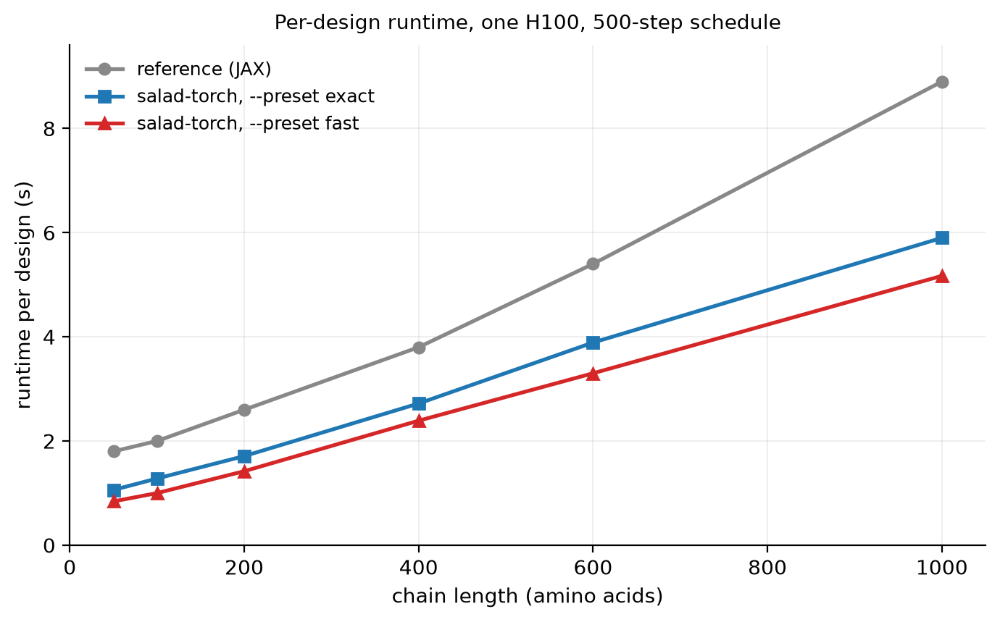

# salad-torch

<p align="center">
  
</p>

*Per-design runtime against chain length, one H100, 500-step schedule, single
design at a time. `--group_size` and `--batch_size` reduce this further at short
lengths — see [Runtime](#runtime).*

A PyTorch implementation of `salad`, loading the released checkpoints directly.
No JAX installation is required to generate structures.

## What's salad?

salad (**s**parse **al**l-**a**tom **d**enoising) is the name of a family of machine learning models for controlled protein structure generation.
Like many previous approaches to protein structure generation (e.g. [RFdiffusion](https://github.com/RosettaCommons/RFdiffusion), [Genie2](https://github.com/aqlaboratory/genie2) and [Chroma](https://github.com/generatebio/chroma)), salad is based on denoising diffusion models and is trained to gradually transform random noise into realistic protein structures.

Unlike previous approaches, salad was developed from the ground up with efficiency in mind. salad outperforms its predecessors by a large margin and thus allows for higher-throughput structure generation. To give an example of how fast salad really is in comparison to previous methods, imagine you want to generate a set of 1,000 amino acid proteins on your previous generation RTX 3090. You start generation and go on a 10 minute coffee break. If you used salad with default settings, you come back to ~45 generated structures. If you used RFdiffusion, you might come back to find one or two.

Like previous models, salad models can generate protein structures for a variety of protein design tasks:
* [unconditional protein generation](#de-novo-protein-design-script)
   up to ~1,000 amino acids
* [symmetric and repeat protein generation](#symmetric--repeat-protein-generation)
  (currently cyclic and screw-axis symmetry)
* [protein motif scaffolding](#multi-motif-scaffolding)
  (with one or more independent motifs)

Shape-conditioned generation and multi-state design are described in the
manuscript but are not implemented here; use the
[reference implementation](https://github.com/mjendrusch/salad) for those. The
full extent of what salad can do is described in the
[manuscript](https://www.biorxiv.org/content/10.1101/2025.01.31.635780v1.abstract).

## What's in this repository?

This repository contains a PyTorch implementation of the models described in
"Efficient protein structure generation with sparse denoising models", together
with the code to train and evaluate them:
- denoising models are implemented in `salad_torch.modules.diffusion` and
  `salad_torch.modules.blocks`.
  - noise schedules in `salad_torch.diffusion.schedules`
- the compiled, CUDA-graph inference path and its presets are in
  `salad_torch.modules.fast`.
- autoencoders are implemented in `salad_torch.modules.encoder`.
- features and attention modules for geometric data are implemented in
  `salad_torch.geometry` and `salad_torch.modules.attention`.
- utilities for working with sparse geometric data are in
  `salad_torch.geometry.segment` and `salad_torch.geometry.frames`.
- checkpoint conversion lives in `salad_torch.convert`.

In addition, it provides modules for loading PDB data and implementing sparse
protein models, and a test suite under `tests/` covering the geometry layer,
the four verified checkpoints, the sampling loop, and the geometry of generated
designs.

Unlike the reference implementation, every generation task is driven by a
single script, `scripts/generate.py`, and selected with flags.

**NOTE: This package has been developed and tested on linux with CUDA.**
**The eager path runs on CPU; `--fast`, `--group_size` and `--batch_size`**
**require a CUDA device.**

# Table of contents

- [salad-torch](#salad-torch)
  - [What's salad?](#whats-salad)
  - [What's in this repository?](#whats-in-this-repository)
- [Getting started](#getting-started)
  - [Installing salad-torch](#installing-salad-torch)
  - [Generating your first proteins](#generating-your-first-proteins)
  - [Runtime](#runtime)
- [salad scripts documentation](#salad-scripts-documentation)
  - [_De novo_ protein design script](#de-novo-protein-design-script)
    - [--config](#--config)
    - [--params](#--params)
    - [--out_path](#--outpath)
    - [--num_aa](#--numaa)
    - [--merge_chains (default: False)](#--mergechains-default-false)
    - [--num_steps (default: 500)](#--numsteps-default-500)
    - [--out_steps (default: 400)](#--outsteps-default-400)
    - [--num_designs (default: 10)](#--numdesigns-default-10)
    - [--prev_threshold (default: 0.8)](#--prevthreshold-default-08)
    - [--timescale_pos (default: "cosine(t)")](#--timescalepos-default-cosinet)
    - [--cloud_std (default: "none")](#--cloudstd-default-none)
    - [--dssp (default: "none")](#--dssp-default-none)
    - [--dssp_mean (default: "none")](#--dsspmean-default-none)
    - [--template (default: "none")](#--template-default-none)
    - [--template_aa (default: False)](#--templateaa-default-false)
    - [--fast](#--fast)
    - [--preset (default: "exact")](#--preset-default-exact)
    - [--group_size (default: off)](#--groupsize-default-off)
    - [--batch_size (default: 1)](#--batchsize-default-1)
    - [--sequence_only (default: False)](#--sequenceonly-default-false)
    - [--order_agnostic (default: False)](#--orderagnostic-default-false)
    - [--renoise (default: False)](#--renoise-default-false)
    - [--sample_final (default: False)](#--samplefinal-default-false)
    - [--sample_final_temperature (default: 0.1)](#--samplefinaltemperature-default-01)
    - [--depth_adjust (default: "none")](#--depthadjust-default-none)
    - [--seed (default: 42)](#--seed-default-42)
    - [--jax_seed](#--jaxseed)
    - [--device, --compile, --timing_json](#--device---compile---timingjson)
  - [Motif scaffolding and binder design](#motif-scaffolding-and-binder-design)
    - [Scaffolding a single motif](#scaffolding-a-single-motif)
    - [Scaffolding several motifs](#scaffolding-several-motifs)
    - [Designing a binder against a target](#designing-a-binder-against-a-target)
  - [Symmetric / repeat protein generation](#symmetric--repeat-protein-generation)
    - [--num_aa](#--numaa)
    - [--replicate_count](#--replicatecount)
    - [--sym_mean (default: "False")](#--symmean-default-false)
    - [--sym_threshold (default: 0.0)](#--symthreshold-default-00)
    - [--screw_translation](#--screwtranslation)
    - [--screw_radius](#--screwradius)
    - [--screw_angle](#--screwangle)
- [Training](#training)
- [Tests](#tests)
- [License](#license)
- [Citation](#citation)

# Getting started
## Installing salad-torch

You can install `salad-torch` the following way:
1. Clone this git repository: `git clone https://github.com/Jetzu/PyTorch-Salad.git`
2. Move to the created directory: `cd PyTorch-Salad`
3. Create and activate the environment:
   `conda env create -f environment.yml && conda activate salad-torch`
4. Install `salad-torch` and its prerequisites: `pip install -e .`

To use pre-trained models, download and extract the set of available
parameters:
```
wget https://zenodo.org/records/14711580/files/salad_params.tar.gz
tar -xzf salad_params.tar.gz
```

`environment.yml` pins Python 3.11, PyTorch 2.5.1+cu121 and numpy 1.26. numpy
must stay below 2.0, because the checkpoints are array pickles that require the
1.x ABI. For a CPU-only install, remove the `pytorch-cuda` line.

Twelve checkpoints are released. Four are covered by the test suite:
`default_vp`, `default_vp_scaled`, `default_ve_scaled` and `multimotif_vp`.
The remaining eight load, but are not verified here.

## Generating your first proteins
After installing `salad-torch` and unpacking the parameters, you are ready to
design your first proteins.

Activate your environment and run the following command to generate proteins
with length 100 amino acids ([full options](#de-novo-protein-design-script)):

```bash
python scripts/generate.py \
    --config default_vp \
    --params params/default_vp-200k.jax \
    --out_path output/my_first_protein/ \
    --num_aa 100 \
    --num_designs 10
```

This will create a directory `output/my_first_protein/` containing PDB files
for each generated protein structure. Let's go through this command line by
line:

`--config default_vp` and `--params params/default_vp-200k.jax` choose a model
configuration and a corresponding set of parameters. You will notice that the
names of parameter files start with the name of the configuration they are
supposed to be used with.

`--out_path` specifies the path to the directory where the outputs will be
saved.

`--num_aa` specifies how many amino acids you want to design. With the
`default_vp` config, generation will work well up to a total of around 400-500
amino acids. You can also specify multiple chains by separating numbers of
amino acids with a colon, e.g. `--num_aa 100:50`.

Finally, `--num_designs` says how many designs you want to generate.

The command above runs the plain eager path, which takes roughly 30 seconds per
design. For anything beyond a couple of structures, add `--fast`, which
compiles the denoiser and captures it in a CUDA graph
([details](#--fast)):

```bash
python scripts/generate.py \
    --config default_vp \
    --params params/default_vp-200k.jax \
    --out_path output/my_first_protein/ \
    --num_aa 100 \
    --num_designs 10 \
    --fast --preset fast --group_size auto
```

This costs a one-time compile of about five minutes and then produces designs
at roughly 0.22 seconds each. `--preset` selects how much numerical deviation
is acceptable ([details](#--preset-default-exact)) and `--group_size` advances
several independent designs through one CUDA graph without changing any of them
([details](#--group_size-default-off)).

To generate large proteins up to 1,000 amino acids, you should use a different
configuration and set of parameters, better suited for large protein
generation:

```bash
python scripts/generate.py \
    --config default_ve_scaled \
    --params params/default_ve_scaled-200k.jax \
    --out_path output/my_large_protein/ \
    --num_aa 1000 \
    --num_designs 10 \
    --fast --preset fast
```

`--group_size` is left out here deliberately: at that length a single forward
pass already saturates the GPU, so grouping designs gains nothing.

See [below](#salad-scripts-documentation) for a detailed description of all
available options.

## Runtime

All numbers below were measured on one H100, on the 500-step default schedule,
and are seconds per finished design.

| length | reference (JAX) | `--preset exact` | `--preset fast` | `fast` + `--group_size auto` |
|---|---|---|---|---|
| 50 | 1.8 s | 1.06 s | 0.84 s | 0.145 s |
| 100 | 2.0 s | 1.28 s | 1.00 s | 0.22 s |
| 200 | 2.6 s | — | — | 0.563 s |
| 400 | 3.8 s | — | — | 1.130 s |
| 600 | 5.4 s | — | — | — |
| 1000 | 8.9 s | — | — | 2.855 s |

Without `--fast` the eager path takes about 30 seconds per design; it exists
for debugging and for CPU, not for production runs.

`--group_size` reclaims GPU idle time between one design's kernel launches, so
it helps most with short chains on a large GPU. `--batch_size` packs several
designs along the residue axis so that each kernel does more work. Throughput
saturates at around 16 designs in flight, and the useful setting is roughly
`batch_size x length` between 400 and 800 residues:

| length | best configuration | s/design |
|---|---|---|
| 50 | `--batch_size 8 --group_size 4` | 0.145 |
| 100 | `--batch_size 8 --group_size 2` | 0.281 |
| 200 | `--batch_size 4 --group_size 2` | 0.563 |
| 400 | `--batch_size 2 --group_size 2` | 1.130 |
| 1000 | `--group_size 2` | 2.855 |

Above about 200 residues the model becomes arithmetic-bound rather than
launch-bound and these options stop paying; at 1,000 residues `--batch_size` is
a net loss, because the pairwise tensors grow quadratically in the batch.

Peak VRAM is approximately `(5.73 * L + 235) + (N - 1) * 4.00 * L` MiB for a
group size of N, and stays linear in length to at least 1,000 residues. A
single design at 1,000 amino acids fits comfortably in 8 GB.


# salad scripts documentation
## _De novo_ protein design script
To generate protein structures _de novo_, without structure-editing
or multi-motif scaffolding, you can use the script  `scripts/generate.py`. It allows the use of different
model configurations and checkpoints and allows to apply simple
constraints such as secondary structure, motifs, length and number of chains, etc.

For example, to use a variance-preserving (VP) salad model to generate
a set of 100 amino acid proteins, you could run the following:

```bash
python scripts/generate.py \
    --config default_vp \
    --params params/default_vp-200k.jax \
    --out_path path_to_outputs/ \
    --num_aa 100 \
    --num_steps 500 \
    --out_steps 400 \
    --num_designs 10 \
    --prev_threshold 0.8 \
    --timescale_pos "cosine(t)"
```

If instead you wish to generate a complex of a 100 amino acid protein
and a 8 amino acid cyclic peptide ligand, you merely need to set
`--num_aa 100:c8`.

To change the type of model you want to use, choose a different
`--config` and adjust the selected `--params` and other options
accordingly. For example, to instead run a VE variance-expanding (VE)
model, you could run:
```bash
python scripts/generate.py \
    --config default_ve_scaled \
    --params params/default_ve_scaled-200k.jax \
    --out_path path_to_outputs/ \
    --num_aa 100 \
    --num_steps 500 \
    --out_steps 400 \
    --num_designs 10 \
    --prev_threshold 0.99 \
    --timescale_pos "ve(t)"
```
Here, you need to change the noise schedule (`--timescale_pos`)
to a VE noise schedule and adjust `--prev_threshold` to 0.99 to
prevent over-use of self-conditioning which results in decreased
designability of generated structures. Recommended values for each
model and each setting are described below.

For a VP model with input-dependent variance, you could use:

```bash
python scripts/generate.py \
    --config default_vp_scaled \
    --params params/default_vp_scaled-200k.jax \
    --out_path path_to_outputs/ \
    --num_aa 100 \
    --num_steps 500 \
    --out_steps 400 \
    --num_designs 10 \
    --prev_threshold 0.8 \
    --timescale_pos "cosine(t)" \
    --cloud_std "default(num_aa)"
```
Here, you need to specify the standard deviation of the
noise distribution using `--cloud_std`. The resulting protein
structures will have a standard deviation of atom positions
close to this value. In this example we set `--cloud_std` to
the `default` function, which was implemented to approximate
the distribution of atom position standard deviations for proteins
of a given length `num_aa`.

Further usage examples can be found in the `scripts/` directory,
which contains all generation and benchmarking scripts that were
used for evaluating salad in the corresponding preprint.

Below you can find an in-depth explanation of all parameters that
can be passed to `scripts/generate.py`, as well as their
default and recommended values.

### --config
Model configuration in (default_vp, default_vp_scaled, default_ve_scaled).
* `default_vp` is the configuration for the fixed-variance
  variance-preserving (VP) model with variance 10 Å.
* `multimotif_vp` is a version of `default_vp` with multi-motif
  conditioning for motif scaffolding.
* `default_vp_scaled` is the configuration for input-dependent
  variance VP model. The standard deviation of the noise distribution
  has to be specified by setting `--cloud_std <value in angstroms>`
  (see below).
* `default_ve_scaled` is the configuration for the variance-expanding
  (VE) model. Using this configuration requires setting
  `--timescale_pos "ve(t)"`,
  or another diffusion time scale compatible with VE diffusion.
  In addition, it is highly recommended to set
  `--prev_threshold` to a value between 0.95 and 0.99.

The full list of implemented configurations can be found in salad/modules/config/noise_schedule_benchmark.py.

### --params
Path to a set of parameters compatible with the selected `--config`.

Parameters can be downloaded from Zenodo ([10.5281/zenodo.14711580](https://doi.org/10.5281/zenodo.14711580)), or obtained from the most recent `salad` code release on GitHub. Parameter sets are named after the underlying configuration and the conditions the parameter checkpoint was saved at. E.g. `default_vp-200k.jax` is a checkpoint
for the `default_vp` configuration taken at 200,000 training steps.

Currently, the following checkpoints are available:
| name | config | notes |
|---|---|---|
|default_vp-200k.jax|default_vp| ~|
|default_vp_scaled-200k.jax|default_vp_scaled| ~|
|default_ve_scaled-200k.jax|default_ve_scaled| ~|
|multimotif_vp-200k.jax|multimotif_vp| VP multi-motif scaffolding model|
|default_vp-pdb256-200k.jax|default_vp| trained on proteins in PDB with <= 256 amino acids |
|default_vp-synthete256-200k.jax|default_vp| trained on synthetic data with <= 256 amino acids |

### --out_path
Path to the output directory where the generated PDB files
will be saved. The directory will be created if it does not exist.
Running `salad` multiple times with the same `--out_path` will 
replace the outputs of previous runs.

### --num_aa
Specifies the number of amino acids in each chain that will be
generated by `salad`.

`--num_aa` can be:
* an integer like `--num_aa 100`, to specify a single chain
  of amino acids.
* an integer prefixed with "c", like `--num_aa c100`, to specify
  a cyclic chain of amino acids (cyclised with a peptide bond).
* a list of (prefixed) integers, separated by ":" like
  `--num_aa 100:c50`, to generate a complex with two or
  more chains of amino acids (linear or cyclic).

For instance, generating a 100 amino acid proteins with 8
amino acid cyclic ligands would be specified as:
`--num_aa 100:c8`

### --merge_chains (default: False)
Specifies if different chains should use the same chain_index
during generation and instead be separated by a gap in the
residue_index. This is not relevant for complex generation
unless using a model that has not been exposed to protein
complexes during training (e.g. the pdb256 and synthete256
checkpoints).

### --num_steps (default: 500)
The total number of diffusion steps to subdivide the interval
$[0, 1]$ of diffusion times. E.g. to set up diffusion over
200 total steps, specify `--num_steps 200`.

### --out_steps (default: 400)
The number of diffusion steps after which to write an output
PDB file. Similar to RFdiffusion, we return structures early
by default (at 400 steps of 500 total steps), as the resulting
structure shows very little change after that point.

`--out_steps` can be:
* a single integer step-count, like `--out_steps 400`.
* a comma-separated list of step-counts, like `--out_steps 0,100,200`.
  This writes a PDB file at _each_ of the specified step counts.

### --num_designs (default: 10)
The number of generated PDB files.

### --prev_threshold (default: 0.8)
Diffusion time threshold for using self-conditioning.
A `--prev_threshold` of 0.8 signifies that self-conditioning should
be used only for diffusion times between 0.8 and 1.0, early in the
denoising process.

`--prev_threshold` should be set to:
* **0.8** for `vp` and `vp_scaled` models.
  Models still produce reasonable results for values > 0.6 and
  start losing quality for lower values.
* **0.99** for `ve_scaled` models. Values > 0.95 still produce 
  reasonable results, but lower values result in an overabundance
  of beta sheet structures.

### --timescale_pos (default: "cosine(t)")
Function mapping diffusion time to a noise schedule. By default,
this is set to a cosine noise schedule "cosine(t)" for VP models.
For VE models, it should be set to "ve(t)".

`--timescale_pos` can be:
* any expression depending on diffusion time "t", that can be 
  expressed in raw python + numpy (as np).
* one of the following pre-defined noise schedules:
  * cosine(t): a cosine noise schedule
  * ve(t, sigma_max=80.0, rho=7.0): the EDM noise schedule
    where sigma_max is the starting standard deviation and
    rho is the exponent. Results in the manuscript were
    generated with sigma_max = 80 Å and sigma_max = 100 Å

### --cloud_std (default: "none")
Expression defining the standard deviation of the noise distribution
for input-dependent variance VP models (`default_vp_scaled`).

`--cloud_std` can be:
* "none", when not used with a VP-scaled model.
* any expression dependent on `num_aa`, the number of amino acids
  and evaluating to a positive number. E.g. `"num_aa ** 0.4"`
* use the default standard deviation scale `"default(num_aa)"`. 
  **This is a reasonable default for generating protein structures**
  **with VP-scaled diffusion and was used throughout the preprint.**

### --dssp (default: "none")
Secondary structure specification. Overrides `--num_aa`.
This is a string of letters "L" (for Loops), "H" (for Helices),
"E" (for shEets) and "_" (for unspecified secondary structure).
E.g.:
```
___HHHHHHHH___EEEEEE___EEEEEE___EEEEE___HHHHHHHH____
```
Alternatively, you may set `--dssp random`. This randomly samples
a secondary structure string of the shape specified in `--num_aa`
and can be used to increase the diversity of generated structures.

By default, no secondary structure constraints are applied.

**NOTE: currently non-random dssp cannot be mixed with other**
**options, such as cyclicity constraints or symmetry constraints.**
**We plan to address this in a future release.**

### --dssp_mean (default: "none")
Either `none`, `random`, or three comma-separated fractions
`loop,helix,sheet` giving the target secondary structure composition of the
design, e.g. `--dssp_mean 0.3,0.5,0.2`. The three values are **not**
renormalised and must already sum to one.

### --template (default: "none")
Specifies an ad-hoc template PDB file for single-motif scaffolding.
Template is a comma-separated tuple of a path to a motif PDB file
and a constraint string:
```
path_to/template.pdb,XXXXXXXXXXFFFFFFXXXXFFFFXXXXXFFFFXXXXXXXXX
```
The constraint string specifies the structure of which amino acids
is specified in the template PDB file. The Nth position marked with
"F" in the constraint string corresponds to the Nth amino acid in the
template PDB file. The constraint string **must** contain exactly as
many "F"s as the number of amino acids in `template.pdb`. "X"s specify
amino acids that can be freely designed.

Please make sure to insert "X"s only at positions where the template
PDB file has gaps in the amino acid chain, otherwise you will generate
nonsensical structures.

**NOTE: as the constraint string specifies the number and sequence**
**positions of freely designable amino acids, this overrides**
**--num_aa and is currently incompatible with --dssp specifications.**
**We plan to address this in a future release.**

**For multi-motif scaffolding, please use the `eval_motif_benchmark*.py` scripts.**

### --template_aa (default: False)
In addition to the template's geometry, condition on its amino acid sequence.
Without this flag only the structure of the template constrains the design, and
the sequence at fixed positions is redesigned along with the rest.


### --fast
Compiles the denoiser with `torch.compile` and captures it in a CUDA graph.
Each sampling step then replays a single graph instead of dispatching several
hundred kernels from Python, which is roughly 20 times cheaper per step.

This costs a one-time compile of about five minutes. It is worth it for
anything beyond two or three designs, and not worth it for a single structure.

`--fast` requires a CUDA device, fixes the chain length for the lifetime of the
process, and cannot be combined with `--sym`. Generating several different
lengths in one process degrades the captured graphs, so run one length per
process.

The compile result is cached by inductor. Point `TORCHINDUCTOR_CACHE_DIR` at
storage that persists between jobs, otherwise the five minute compile is paid
again on every machine — `/tmp` is node-local on most clusters. Budget roughly
3,800 files and 280 MB per compiled length.

### --preset (default: "exact")
Chooses how much numerical deviation from the reference implementation is
acceptable. Only has an effect together with `--fast`.

* `exact` runs the full-precision path. This is the default.
* `fast` enables TF32 matmuls, halves the sampling schedule, and uses two
  reassociated contractions. About 20 % faster per step, and half as many
  steps.
* `deterministic` runs the `exact` path with non-atomic segment reductions, so
  that `--seed` reproduces a run on CUDA. It is slower than `exact`.

The `fast` preset was compared against `exact` over 160 designs per arm on
CA-CA bond length, radius of gyration, secondary structure composition, clash
count and divergence rate. None of those distributions shift measurably. Most
of its advantage per design comes from the halved schedule rather than from the
faster step.

`deterministic` exists because `--seed` alone does not pin a CUDA run; see
[--seed](#--seed-default-42). Its output differs slightly from the other two
presets, so it is a tool for reproducing a run, not a default.

### --group_size (default: off)
Advances several independent designs through a single CUDA graph. Requires
`--fast`.

This is not a batch dimension and not a shared trajectory. Each design keeps
its own buffers, its own noise and its own seed-derived random stream, and
produces exactly the structure it would have produced on its own. The only
thing that changes is that the GPU stops idling between one design's serialised
kernel launches.

`--group_size auto` measures the best group size on the device you are actually
running on, by capturing the graph at increasing sizes until the gain drops
below 3 % or memory runs out. Prefer it to a fixed number, which will be wrong
on a different GPU. `--group_size 1` uses the grouped machinery with a group of
one and reproduces the ungrouped path.

Because the gain comes from idle multiprocessors, it is largest for short
chains on a large GPU and shrinks towards nothing for long chains or small
GPUs.

### --batch_size (default: 1)
Packs several designs along the flat residue axis, so that each kernel does
more work per launch. Can be combined with `--group_size`.

Unlike `--group_size`, this does change each design's arithmetic: a larger
matrix multiplication picks a different tiling and accumulation order. The
resulting structures are distributionally equivalent to unpacked ones, but not
identical.

It is worth about 42 % at 50 amino acids and 16 % at 100 on top of
`--group_size`, nothing at 400, and is a net loss at 1,000, where the pairwise
tensors grow quadratically in the batch. As a rule of thumb, choose
`--batch_size` so that `batch_size x length` lands between 400 and 800
residues.

### --sequence_only (default: False)
Writes the designed sequences as FASTA to `{out_path}/sequences.fa` instead of
writing PDB files.

### --order_agnostic (default: False)
Hides residue order from the network, by passing `resi = -1` and `chain = 0`.
The output PDB is re-threaded afterwards by following C-N backbone contacts
instead of relying on the network's indexing.

### --renoise (default: False)
At every out-step, additionally runs nine independent partial re-denoising
passes, re-entering the trajectory at `raw_t = 0.4` with self-conditioning
switched off. This is expensive — roughly a threefold increase in wall-clock
time per design — and changes PDB naming to
`result_{design}_{idr}_{step}.pdb`.

### --sample_final (default: False)
On out-steps only, replaces the single-shot sequence decode with an `L`-step
categorical random-order autoregressive re-decode, and then rebuilds sidechains
from the result. Costs `L` additional decoder-only forward passes per out-step.

### --sample_final_temperature (default: 0.1)
Softmax temperature for `--sample_final`.

### --depth_adjust (default: "none")
Either `none`, or an integer not greater than the checkpoint's native trunk
depth (6 for `default_vp`). Builds and loads only the first N trunk blocks, as
an early-exit ablation. Values above the native depth are not supported, since
there are no further trained weights to load.

### --seed (default: 42)
Seeds the noise draw.

**On CUDA this does not by itself reproduce a run.** Segment reductions use
`scatter_add`, whose atomic accumulation order varies between runs; the
neighbour selection turns that variation into a discrete change, and the
sampling steps amplify it. Two identical commands differ in roughly 48 % of
residues. Add `--preset deterministic` if you need reproducibility. On CPU
everything is already deterministic.

### --jax_seed
An alias for `--seed`, accepted so that command lines written for the reference
implementation run unchanged. It does not make the two implementations produce
the same structures — their random number generators are unrelated.

### --device, --compile, --timing_json
`--device` defaults to `cuda` when one is available. `--compile` passes a
`torch.compile` mode for the eager path, independently of `--fast`, which
manages its own compilation. `--timing_json` writes a timing breakdown to the
given path.


## Motif scaffolding and binder design

Both tasks use `--template`, and differ only in what the constraint string
says. The syntax is described under [--template](#--template-default-none):
a path to a PDB file, a comma, and then one character per residue of the
design, with `F` marking a position taken from the template, any other
character (conventionally `_`) marking a free position, and `:` separating
chains.

The template PDB must contain exactly as many residues as there are `F`
characters, and they are matched in file order. A mismatch raises an error
rather than silently misaligning.

### Scaffolding a single motif

Place a 12-residue motif in the middle of a 60-residue design:

```bash
python scripts/generate.py \
    --config default_vp \
    --params params/default_vp-200k.jax \
    --out_path output/scaffold/ \
    --num_designs 100 \
    --template motif.pdb,____________________FFFFFFFFFFFF____________________________
```

### Scaffolding several motifs

Several separate runs of `F` in one constraint string give several independent
motifs. The distance map is only applied between pairs of positions that both
came from the template, so unrelated motifs are not forced into a fixed
relative arrangement unless they were adjacent in the template:

```bash
    --template motifs.pdb,______FFFFFF__________FFFF________FFFFFFFF__________
```

`multimotif_vp` is trained with explicit multi-motif conditioning and is the
better choice here, but any configuration works:

```bash
python scripts/generate.py \
    --config multimotif_vp \
    --params params/multimotif_vp-200k.jax \
    --out_path output/multimotif/ \
    --num_designs 100 \
    --template motifs.pdb,______FFFFFF__________FFFF________FFFFFFFF__________
```

### Designing a binder against a target

A `:` in the constraint string starts a new chain. Marking every position of
the first chain `F` and leaving the second chain free gives a fixed target and
a designed binder:

```bash
python scripts/generate.py \
    --config default_vp \
    --params params/default_vp-200k.jax \
    --out_path output/binder/ \
    --num_designs 100 \
    --template target.pdb,FFFFFFFFFFFFFFFFFFFFFFFFFFFFFF:______________________________
```

Here `target.pdb` supplies 30 residues, which become chain A and are held
fixed, and 30 free positions in chain B are designed against them. The binder's
length is set by how many free positions you write, so it is varied by editing
the constraint string rather than with `--num_aa` — `--template` overrides
`--num_aa` entirely.

Add `--template_aa` to condition on the target's sequence as well as its fold;
without it the target's own residues are redesigned, which is usually not what
you want for a binder.

Interface residues on the target can be left free by writing `_` at those
positions, which lets the model adjust them rather than treating the target as
rigid.

## Symmetric / repeat protein generation
To generate rotation or superhelical (screw) symmetric repeat proteins,
you can use the script `scripts/generate.py`.
Currently, this script only supports cyclic or screw-axis symmetries.
By specifying an angle of rotation, distance from center and translation
along the symmetry axis, this allows generating superhelical repeat
proteins with a fully specified geometry.

This script takes the usual denoising process settings (--num_designs, --num_steps, --out_steps, --prev_threshold, --config, --params, --timescale_pos),
as well as `--num_aa` compatible with `scripts/generate.py`.
In addition, it requires inputs for `--screw_radius`, which specifies
the repeat unit distance from the symmetry axis in angstroms (center-of-mass radius
of the resulting superhelix); `--screw_angle`, which specifies the
rotation angle around the symmetry axis for successive repeat units;
`--screw_translation`, which specifies the translation along the symmetry
axis in angstroms between two successive repeat units.

For example, generating C3-symmetric repeat proteins works as follows:
```bash
monomer_size=50
repeat_count=3
total_count=$(($monomer_size * $repeat_count))
python scripts/generate.py \
    --config default_ve_scaled \
    --params params/default_ve_scaled-200k.jax \
    --num_aa $total_count \
    --out_path path_to_output/ \
    --num_steps 500 --out_steps "400" \
    --prev_threshold 0.98 --num_designs 20 --timescale_pos "ve(t)" \ 
    --screw_radius 10.0 --screw_angle 120.0 \
    --screw_translation 0.0 --replicate_count 3 \
    --sym c3
```
To generate a screw-symmetric structure instead, it suffices to set
`--screw_translation` to a non-zero value.

While this script can be used with any model configuration, generating
screw-symmetric proteins works best with VE models.

A detailed explanation of all arguments to `scripts/generate.py` is given below.

### --num_aa
This works as in `scripts/generate.py`. However, care needs
to be taken that the chain lengths specified are compatible with the
applied symmetry operation. E.g. for --replicate_count 3, --num_aa needs
to be divisible by 3, or consist of 3 chains of equal length, e.g.:
```
--num_aa 150
--num_aa 50:50:50
```

### --replicate_count
Number of copies of a repeat. E.g. for a C3-symmetric repeat protein,
one should use --replicate_count 3.

### --sym_mean (default: "False")
Given as the literal string `True` or `False`. Controls whether the initial
positions and the per-step post-hoc symmetriser average over subunits.

Note that the symmetriser applied to the network's noised *input* always
behaves as if this were `False`, regardless of the flag. This matches the
reference implementation.

### --sym_threshold (default: 0.0)
The post-hoc per-step symmetrisation is applied only while `raw_t` is above
this threshold. At the default of `0.0` every step is symmetrised; raising it,
for instance to `0.5`, relaxes the symmetry constraint for the late, low-noise
part of the trajectory.

### --screw_translation
Translation along the central axis of rotation between two successive
repeat units. If this is 0.0, this will result in a repeat protein
or assembly with cyclic symmetry. Otherwise it will result in a 
superhelical (screw) symmetry.

### --screw_radius
Radius in angstroms at which repeats should be placed from the central
axis of rotation. Allows to control the radius of a cyclic or 
screw-symmetric repeat protein or assembly.

### --screw_angle
Angle of rotation between two successive repeat units around the central
axis of rotation. For designs with --screw_translation 0.0 this needs to
be less than or equal to 360 / --replicate_count, as it will result in
clashing structures otherwise.

# Training

Training is implemented, including all loss terms, the optimiser step and
bin-packed batching of several proteins per step, mirroring the reference
implementation's scheme.

```bash
python -m salad_torch.training.train --synthetic --num_aa 1024
```

Two data sources are wired up. The synthetic source
(`--synthetic`, the default) generates idealised geometry in memory and needs
no preprocessed data, so it runs immediately. The real-PDB source
(`--data-path PATH`) reads a preprocessed `.npz` assembly tree; it is
implemented but has not been exercised here, since no such tree was available
during development.

Multi-device training (`rebatch`, `multigpu`, `pmap` in the reference
implementation) is not ported. If you wrap the model in
`DistributedDataParallel`, it needs `find_unused_parameters=True`: the released
checkpoints carry bias tensors for layers configured without bias, and those
parameters never receive a gradient.

# Tests

```bash
SALAD_CONFIG=default_vp python tests/test_model_parity.py
python tests/test_geometry_parity.py
python tests/test_design_quality.py --n 160 --preset fast
```

`test_model_parity.py` checks a configuration's outputs against stored
reference tensors, `test_geometry_parity.py` covers the 38 geometry functions,
and `test_design_quality.py` generates designs and checks their geometry — bond
lengths, radius of gyration and divergence rate. The last of these catches a
class of defect the per-tensor tests cannot see, because a fault that only
appears after hundreds of sampling steps is invisible to a single forward pass.

Note when comparing sampling trajectories: a single forward pass is
reproducible to about 2e-7, but feeding the output back in for 500 steps
amplifies floating-point reduction-order differences. Compare against a rerun
of the same code, not against a fixed absolute tolerance.

# License

This repository combines material under three licences; see
[`LICENSE`](LICENSE) for the full text.

**Original salad code** — Copyright (c) 2025 European Molecular Biology
Laboratory (EMBL), licensed under the
[Apache License 2.0](http://www.apache.org/licenses/LICENSE-2.0). The model
architecture and algorithms originate there.

**Model parameters** — licensed by EMBL under
[CC BY 4.0](https://creativecommons.org/licenses/by/4.0/). They are downloaded
separately and their licence is unchanged by this repository.

**This port** — the PyTorch implementation, the code written for it, the tests
and the documentation are licensed under the
[PolyForm Noncommercial License 1.0.0](https://polyformproject.org/licenses/noncommercial/1.0.0/):
free to use, modify and share for noncommercial purposes, which includes
personal use, research, education and use by charitable organisations.

This applies only to the material added here. The Apache-2.0 material above
remains available under its own terms.

# Citation

If you use this software, please cite the original work:

```
Jendrusch, M. et al. Efficient protein structure generation with sparse
denoising models. bioRxiv 2025.01.31.635780.
```
